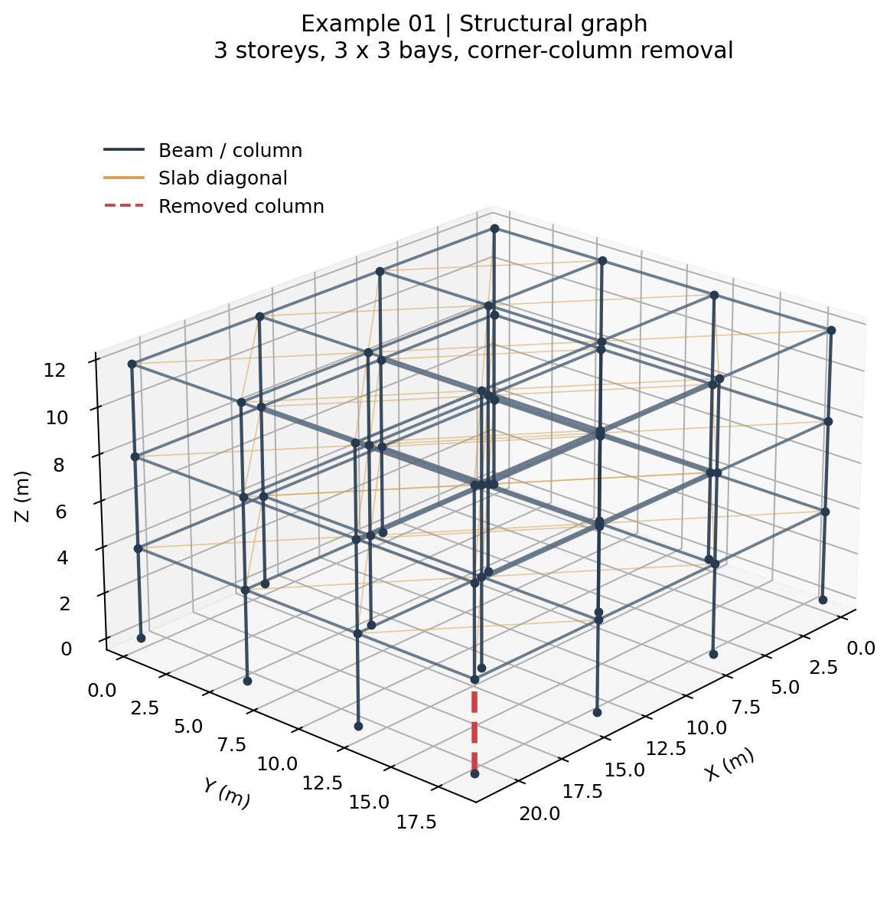
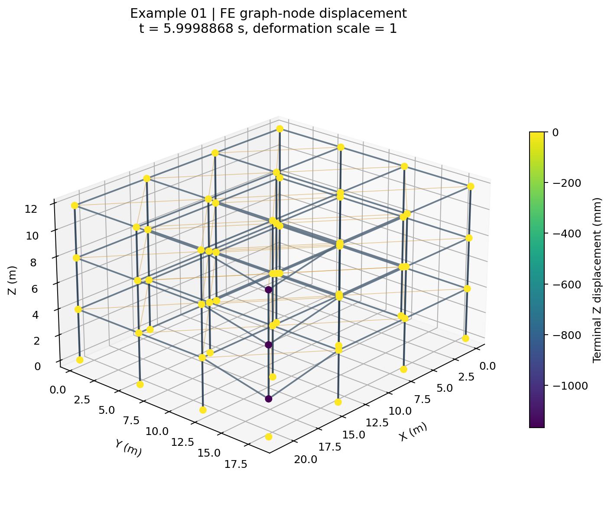

# GAT-Transformer

Network architecture and a worked finite-element example for residual displacement prediction of reinforced-concrete frames.

[Paper](https://doi.org/10.1016/j.aei.2026.105334)

## Contents

```text
model.py
training.py
example.py
verify_example.py
plot_example.py
example/
  model.k
  case.json
  graph.json
  nodes.csv
  edges.csv
  results/
    nodout_terminal.txt
    displacement.csv
  figures/
    graph.png
    terminal_displacement.png
```

`model.py` contains the node and edge projections, three GATv2 layers, global Transformer, global-feature bypass, separate XY/Z regression heads, and the physical-scale loss. The default hidden dimension is 128, with eight attention heads and dropout 0.1. `training.py` supplies the training loop, AdamW optimizer, automatic mixed precision, and ReduceLROnPlateau scheduler.

## Environment

Python 3.10 or newer:

```bash
python -m pip install -r requirements.txt
```

For regenerating the figures:

```bash
python -m pip install -r requirements-plot.txt
```

## Example 01

The example is a three-storey rectangular frame with three bays in each plan direction and one ground-storey corner column removed. The global coordinate system uses Z as the vertical axis. Geometric coordinates and displacement results are expressed in metres.

| Item | Value |
| --- | --- |
| Storeys | 3 |
| Bays | 3 × 3 |
| Plan dimensions | 21.403772 × 18.460127 m |
| Height | 11.798888 m |
| FE nodes | 3352 |
| Beam elements | 948 |
| Shell elements | 1944 |
| Beam/column element lengths | 0.561851–0.792733 m |
| Shell edge lengths | 0.769171–0.792733 m |
| Graph nodes | 64 |
| Graph connections | 174 |
| Directed graph edges | 348 |
| Removed column endpoints | FE nodes 1015 and 1031 |
| Simulation end time | 6.0 s |
| Included result time | 5.9998868 s |

`model.k` is a self-contained LS-DYNA keyword deck containing the FE mesh, material and section definitions, boundary conditions, loading, initial removal setup, control cards, and output requests. Open it in LS-PrePost to inspect the model, or use it as the input deck for an LS-DYNA calculation. The model uses the metre–kilogram–second unit system.

`case.json` records the example geometry, mesh counts, removed-column endpoints, result time, and displacement scale.



## Graph representation

`graph.json` stores the model-ready, dimensionless feature matrices, directed adjacency, physical node coordinates, FE node identifiers, and feature-column order.

| Field | Shape | Meaning |
| --- | --- | --- |
| `x` | 64 × 15 | Node features |
| `edge_index` | 2 × 348 | Directed adjacency |
| `edge_attr` | 348 × 8 | Edge features |
| `global_attr` | 1 × 13 | Building-level features |
| `positions_m` | 64 × 3 | Initial physical coordinates |
| `node_ids` | 64 | Corresponding FE node identifiers |

The feature order follows Table 2 of the paper:

- Node: x, y, z, n, m, Phi1, Phi2, Phi3, Tagfail, Tagsup, Tagroof, ISLD, delta_x, delta_y, delta_z.
- Edge: Tcomp, Dlevel, hc, bc, L, ts, E, rho.
- Global: N, H, Nx, Ny, h, X, Y, DL, LL, fc, fy, eta, S.

The feature matrices are supplied in their prepared input space. `positions_m` provides the physical coordinates separately. For additional graphs, apply a consistent feature-scaling convention before model input.

`nodes.csv` maps each zero-based graph index to an FE node, coordinate, floor, and initial-state tag. `edges.csv` contains each of the 174 undirected connections once. Types 0, 1, and 2 identify columns, beams, and slab diagonals, respectively. The graph contains 48 column, 72 beam, and 54 slab-diagonal connections. An initial damage value of 1 identifies the removed column.

`edge_index` contains both `(i, j)` and `(j, i)` for every connection, with identical edge attributes. The removal ratio in the global features is 1/48.

## Finite-element results

`nodout_terminal.txt` contains the original translation output block at the included result time. `displacement.csv` contains the X/Y/Z displacements of the 64 graph nodes extracted from that block. Its columns are:

```text
graph_index, node_id, time_s, ux_m, uy_m, uz_m
```

Rows follow the same node order as `graph.json`. The figure displays these FE graph-node results on the displaced graph using a deformation scale of 1.



## Verify and run

Check the FE-node references, graph mapping, edge directions, and agreement between the CSV and original output block:

```bash
python verify_example.py
```

Load the graph and execute two optimization steps:

```bash
python example.py --steps 2
```

Inspect the input without optimization, or export the PyG object:

```bash
python example.py --steps 0
python example.py --steps 0 --export-pt results/example_graph.pt
```

The example uses `target_scale_m = [1, 1, 1]`, so `y` is expressed in metres. The XY and Z losses use physical squared displacement. Each execution prints the graph dimensions, result time, and loss for each optimization step.

Regenerate the two figures:

```bash
python plot_example.py
```

## Training interface

```python
from example import load_example
from model import GATTransformer

graph, case = load_example("example")
model = GATTransformer()
prediction = model(graph)
```

For a collection of prepared graphs, `fit` accepts separate training and validation datasets:

```python
from model import GATTransformer
from training import fit

model, history = fit(
    GATTransformer(),
    training_data,
    validation_data,
    scale=(1.0, 1.0, 1.0),
    epochs=300,
    batch_size=72,
)
```

Predictions and targets use the same normalized output space; `scale` converts each displacement component to physical units. The model returned by `fit` uses the epoch with the lowest validation loss. Initial and minimum learning rates default to 1e-4 and 1e-6, respectively.
